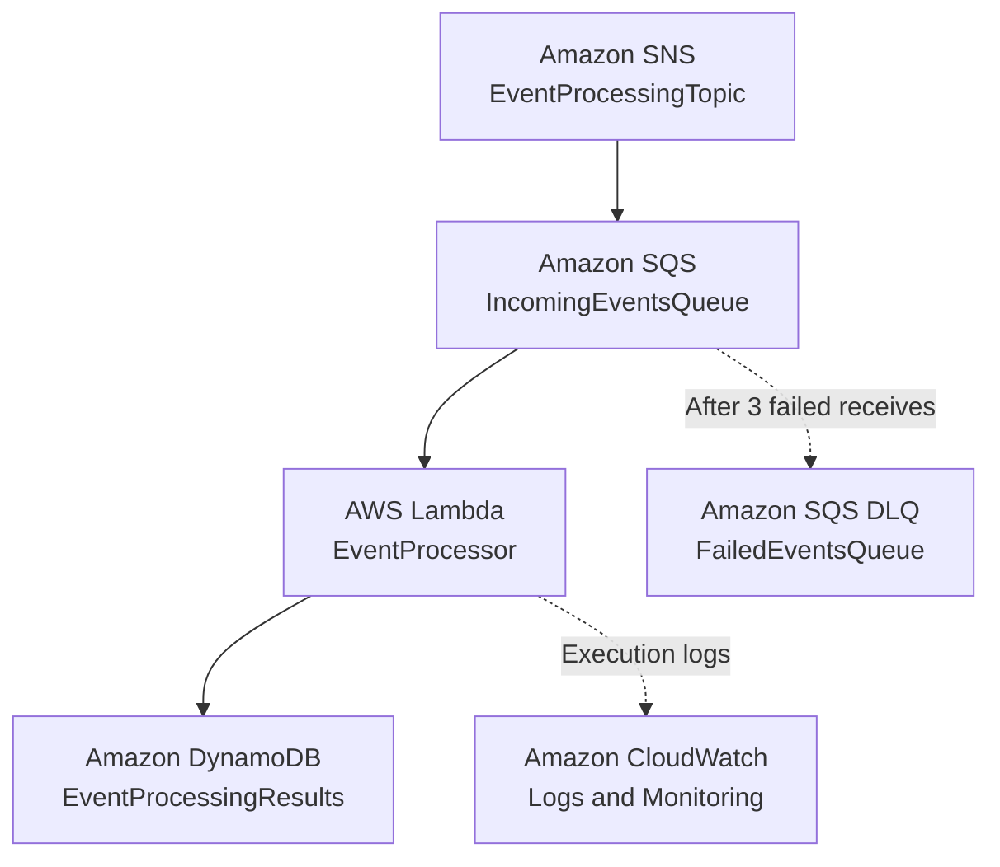
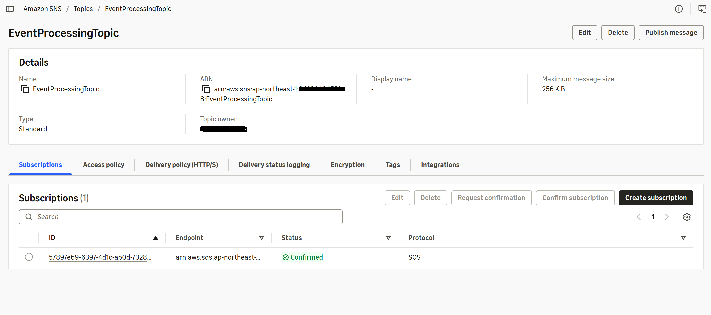
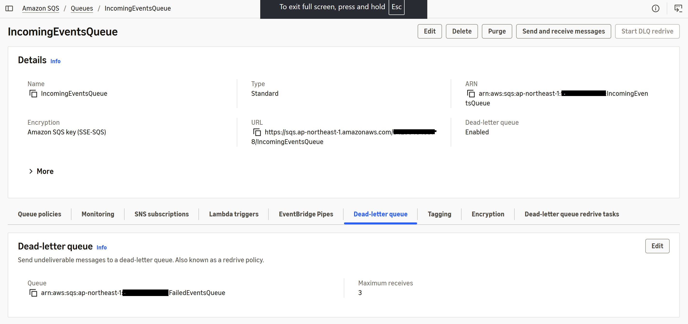
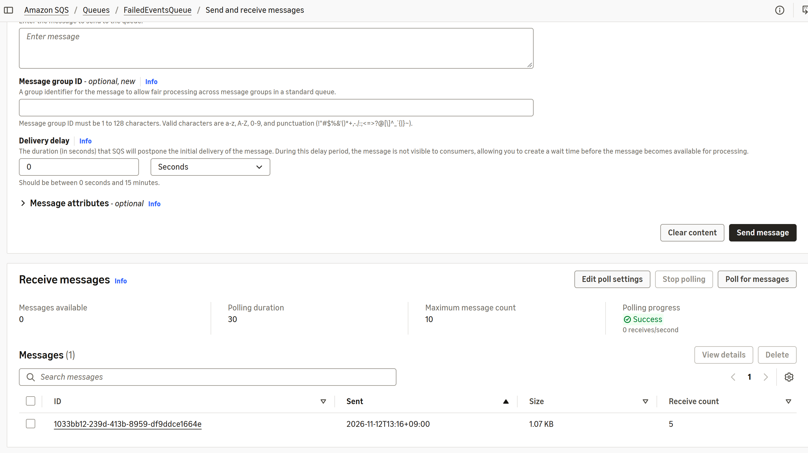
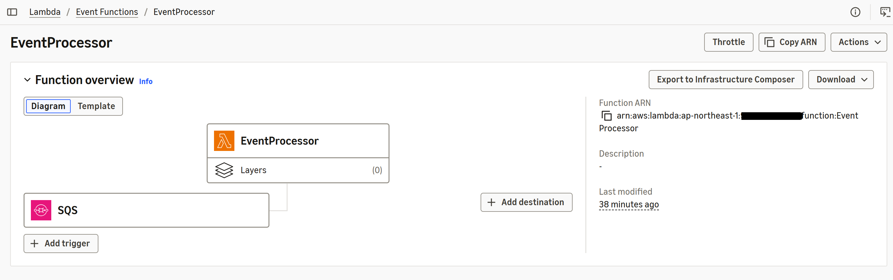
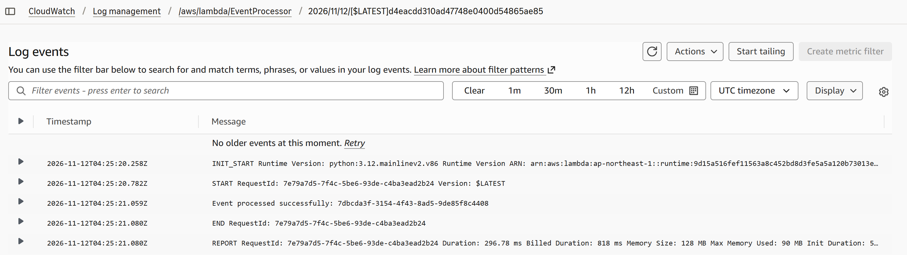
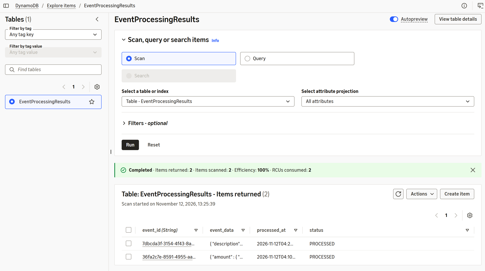

# AWS Event-Driven Architecture

## Project Overview

This project demonstrates an event-driven architecture built using AWS managed services. It uses Amazon SNS to publish events, Amazon SQS to queue messages, AWS Lambda to process events, and Amazon DynamoDB to store processing results.

The architecture also implements an Amazon SQS Dead Letter Queue (DLQ) to capture messages that repeatedly fail processing.

## Architecture

**Event Flow:**

1. Amazon SNS publishes an event.
2. Amazon SQS receives and stores the message.
3. AWS Lambda automatically polls the main SQS queue and processes the event.
4. Successfully processed events are stored in Amazon DynamoDB.
5. CloudWatch captures Lambda execution logs.
6. Messages that repeatedly fail processing are moved to the Dead Letter Queue.

## AWS Services Used

| AWS Service | Purpose |
|---|---|
| Amazon SNS | Publishes event notifications |
| Amazon SQS | Queues incoming events |
| Amazon SQS DLQ | Stores repeatedly failed messages |
| AWS Lambda | Processes events using Python |
| Amazon DynamoDB | Stores processing results |
| AWS IAM | Manages permissions using least privilege |
| Amazon CloudWatch | Monitors execution logs and errors |

## Architecture Components

- **SNS Topic:** `EventProcessingTopic`
- **Main SQS Queue:** `IncomingEventsQueue`
- **Dead Letter Queue:** `FailedEventsQueue`
- **Lambda Function:** `EventProcessor`
- **DynamoDB Table:** `EventProcessingResults`
- **Lambda IAM Role:** `EventProcessorLambdaRole`

## Failure Handling

The main SQS queue is configured with a Dead Letter Queue.

Messages that fail processing repeatedly are moved to `FailedEventsQueue` after reaching the configured maximum receive count of 3.

This allows failed messages to be retained for troubleshooting without blocking normal event processing.

## Testing and Validation

The architecture was tested with both successful and failed events.

**Successful Processing Test**
- Published a test event through SNS.
- Verified delivery to the main SQS queue.
- Confirmed Lambda execution.
- Verified that the processing result was stored in DynamoDB.
- Confirmed successful execution in CloudWatch.

**Failure Handling Test**
- Temporarily introduced an intentional exception in Lambda.
- Published a test event through SNS.
- Verified Lambda processing failures and retries.
- Confirmed that the failed message was moved to `FailedEventsQueue`.
- Restored the original Lambda code.
- Published another test event and verified successful processing.

## Security and Permissions

IAM permissions follow the principle of least privilege.

The Lambda execution role uses:
- `AWSLambdaBasicExecutionRole` for CloudWatch logging.
- SQS permissions for receiving, deleting and managing message visibility.
- DynamoDB `PutItem` permission for storing processing results.

SNS is allowed to send messages to the main SQS queue through a restricted queue access policy.

## Project Screenshots

### 1. SNS Topic

### 2. SQS Main Queue and DLQ Configuration

### 3. Dead Letter Queue

### 4. Lambda Function

### 5. CloudWatch Logs

### 6. DynamoDB Processing Results

## Key Learning Outcomes

- Building event-driven architectures using AWS managed services.
- Understanding SNS and SQS integration.
- Configuring SQS Dead Letter Queues.
- Connecting SQS to Lambda using event source mappings.
- Implementing Lambda execution roles and least-privilege IAM policies.
- Storing event-processing results in DynamoDB.
- Monitoring Lambda executions using CloudWatch.
- Testing successful and failed message-processing scenarios.

## Region

Asia Pacific (Tokyo) — `ap-northeast-1`

